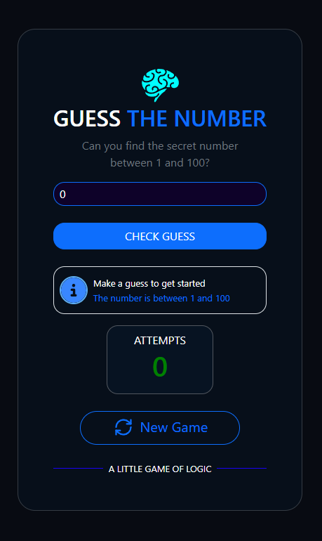

# 🎯 GUESS THE NUMBER

A simple and interactive number guessing game built with React and Bootstrap.

Try to find the secret number between 1 and 100!

## 📸 Screenshot



## ✨ Features

* Random secret number between 1 and 100
* Interactive feedback based on how close your guess is
* Attempt counter
* Animated feedback messages
* New Game button to restart the game


## 🛠️ Built With

* React
* Vite
* Bootstrap 5
* React Icons
* CSS

## 🚀 Getting Started

### Prerequisites

Make sure you have [Node.js](https://nodejs.org/en/download) installed on your system.

### Installation

1. Clone the repository:

   ```bash
   git clone https://github.com/reza-sv/Guess-It.git
   ```

2. Navigate to the project directory:

   ```bash
   cd Guess-It
   ```

3. Install dependencies:

   ```bash
   npm install
   ```

4. Start the development server:

   ```bash
   npm run dev
   ```

5. Open the local URL shown in your terminal in your browser.


## 🏗️ Build

To create a production build, run:

```bash
npm run build
```

The production files will be generated in the `dist` directory.


Created as a practice project while learning React.
